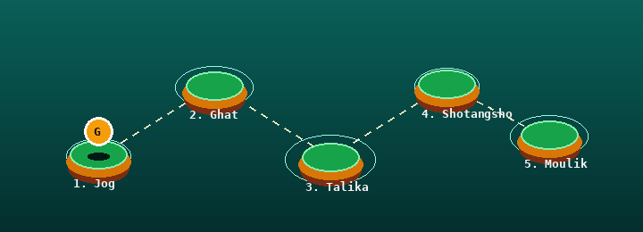
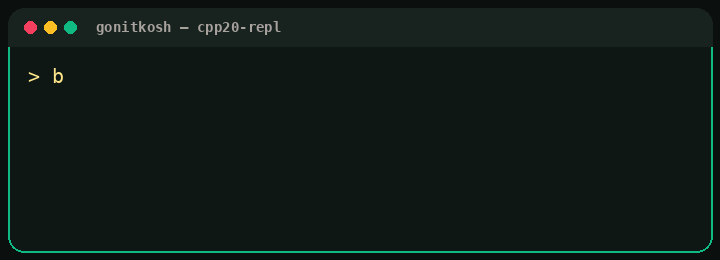

<!-- Project Banner -->
<p align="center">
  
</p>

<h1 align="center">গণিতকোষ (GonitKosh)</h1>

<p align="center">
  <strong>Explore Mathematics. Learn Through Play. Code in Bangla.</strong>
</p>

<p align="center">
  An interactive, game-like web platform and C++20 mathematics library
  featuring Bangla function names.
</p>

<p align="center">
  Built with Next.js 14, React, Tailwind CSS and C++20.
  No backend required.
</p>

---

## 🚀 Live Previews

<table>
  <tr>
    <th align="center">🏝️ Island Quest (3D Archipelago)</th>
    <th align="center">💻 All-in-One REPL Console</th>
  </tr>
  <tr>
    <td align="center">
      
    </td>
    <td align="center">
      
    </td>
  </tr>
</table>

---

## ✨ Features

### 🏝️ Island Quest — 3D Mathematics Adventure

- Explore a 3D archipelago containing 8 progressive mathematics islands.
- Customize your explorer avatar using `public/scholar.png`.
- Solve mathematical challenges and earn up to 24 stars.
- Star-based scoring system:
  - `0 mistakes = 3★`
  - `1–2 mistakes = 2★`
  - `3+ mistakes = 1★`

### 📚 Function Lab

- Explore and test all 26 built-in Bangla mathematics functions.
- Includes functions such as:
  - `jog()` — Addition
  - `biyog()` — Subtraction
  - `gun()` — Multiplication
  - `bhag()` — Division
  - `gosagu()` — GCD
  - `moulik()` — Prime number checking
- Provides live C++-style error reporting.

### 💻 All-in-One REPL Console

- Execute mathematical expressions directly in the browser.
- Supports nested function expressions.

Example:

```cpp
borgo(jog(2, 3))
```

- Supports list operations.

Example:

```cpp
gorh({1, 2, 3})
```

- Includes a complete mathematical function cheat sheet.

### 🎯 Practice Arena

- Solve 10 guided mathematics challenges.
- Get hints while solving problems.
- Track your progress automatically.
- Progress is saved using browser `localStorage`.

---

## 🛠️ Technologies Used

| Technology | Purpose |
|---|---|
| Next.js 14 | React framework |
| React | UI development |
| JavaScript | Application logic |
| Tailwind CSS | Styling |
| C++20 | Mathematics library |
| HTML5 | Web structure |
| CSS3 | Animations and 3D styling |
| LocalStorage | Progress persistence |

---

## 📂 Project Structure

```text
gonitkosh-web/
│
├── app/
│   ├── globals.css
│   ├── layout.js
│   └── page.js
│
├── components/
│   ├── World.js
│   ├── Docs.js
│   └── Ic.js
│
├── lib/
│   ├── gk.js
│   └── data.js
│
├── cpp/
│   ├── gonitkosh.hpp
│   └── main.cpp
│
├── public/
│   └── scholar.png
│
├── gonitkosh_repo_banner.svg
├── gonitkosh-islands.gif
├── gonitkosh-console.gif
│
├── .gitignore
├── next.config.js
├── package.json
├── package-lock.json
├── postcss.config.js
├── tailwind.config.js
└── README.md
```

---

## ⚙️ Getting Started

Follow these steps to run GonitKosh locally.

### 1. Clone the Repository

```bash
git clone https://github.com/joygoswaminiloy2023-droid/Gonitkosh.git
```

### 2. Navigate to the Project

```bash
cd Gonitkosh
```

### 3. Install Dependencies

```bash
npm install
```

### 4. Start the Development Server

```bash
npm run dev
```

Open your browser and visit:

```text
http://localhost:3000
```

### 5. Build for Production

```bash
npm run build
```

The static production export is generated in the `out/` directory.

---

## 📖 C++ Mathematics Library

GonitKosh includes an original C++20 mathematics library.

**Header file:**

```cpp
#include "gonitkosh.hpp"
```

The library provides Bangla-named mathematical functions with C++-style error handling.

The JavaScript implementation in `lib/gk.js` mirrors the C++ library in `cpp/gonitkosh.hpp`.

---

## 📝 Notes

- `lib/gk.js` mirrors `cpp/gonitkosh.hpp` so calculations and exceptions remain consistent between the JavaScript and C++ implementations.
- Edit `lib/data.js` to add new functions, island levels, or practice problems.
- The application does not require a backend server.
- User practice progress is stored locally using browser `localStorage`.
- The project supports static export through Next.js.

---

## 👨‍💻 Developer

<p align="center">
  <strong>Joy Goswami Niloy</strong>
  <br />
  Computer Science & Engineering
</p>

<p align="center">
  <a href="https://github.com/joygoswaminiloy2023-droid">
    GitHub Profile
  </a>
  &nbsp; • &nbsp;
  <a href="https://github.com/joygoswaminiloy2023-droid/Gonitkosh">
    Project Repository
  </a>
</p>

---

<p align="center">
  <strong>গণিত শিখুন, যুক্তি গড়ুন, প্রযুক্তিতে এগিয়ে যান!</strong>
  <br />
  <sub>Learn Mathematics. Build Logic. Move Forward with Technology.</sub>
</p>
